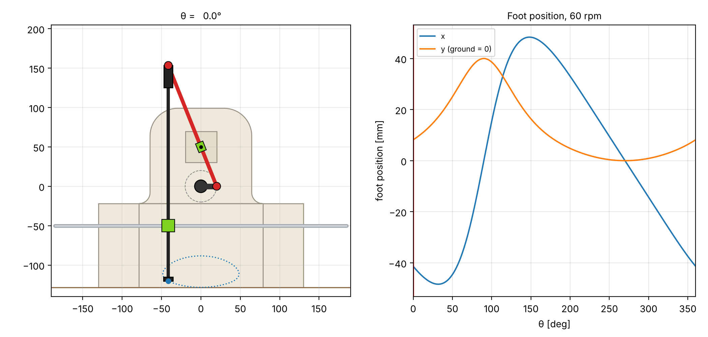
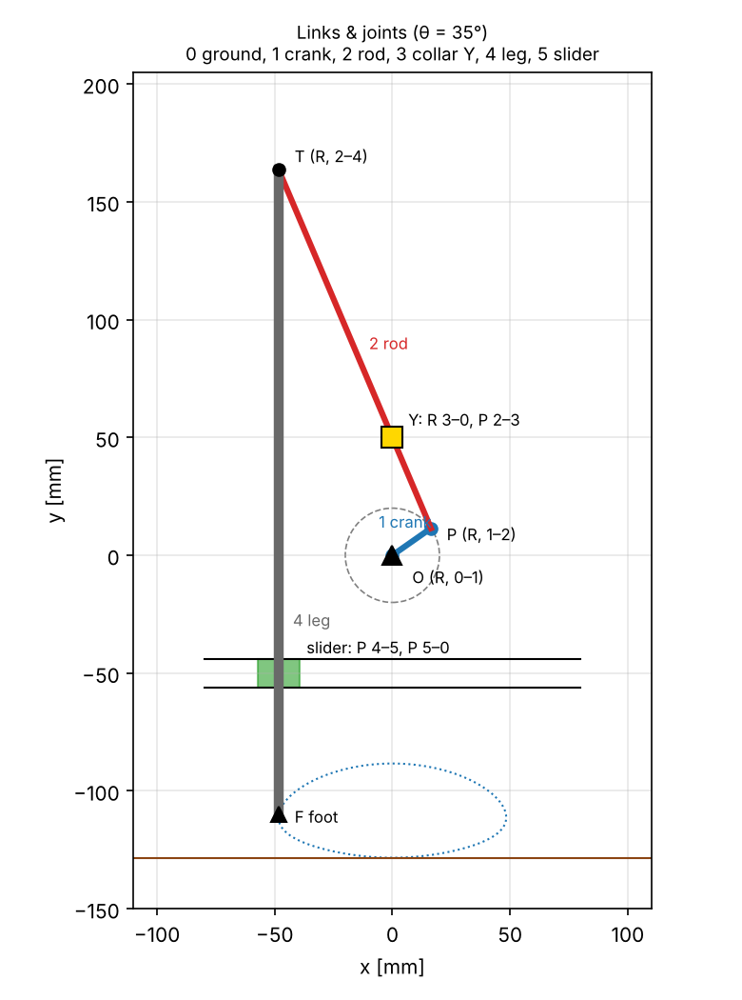
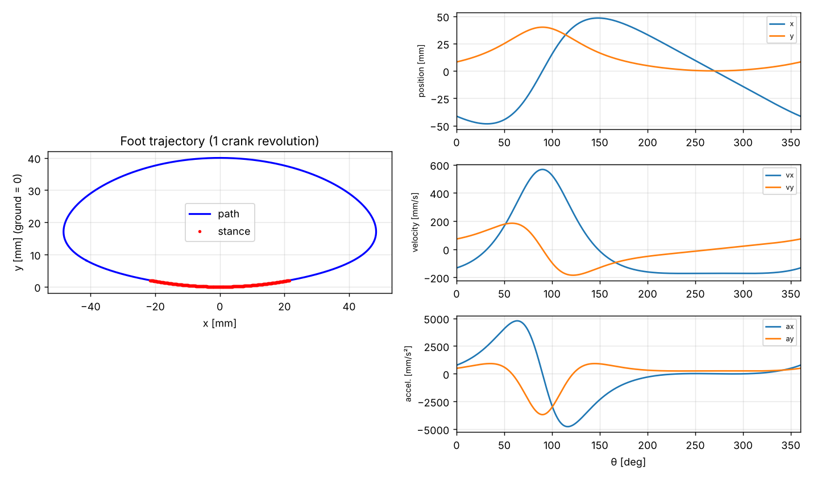

# Linkage Walking Mechanism

**กลุ่ม ราชาแมชชีน**

| # | ชื่อ – นามสกุล | รหัสนิสิต | หน้าที่ |
|---|---|---|---|
| 1 | ก้องภพ เพียรการ | 6730027821 | Symbolic Math |
| 2 | ณฐพัชร์ อานันท์ภิวัฒน์ | 6730133621 | Hardware |
| 3 | ณพล อัตถากร | 6730137121 | Multibody |

วิเคราะห์จลนศาสตร์ของกลไกเดินแบบ linkage ขาเดียวด้วย Symbolic Math, จำลองด้วย Simscape Multibody และสร้างชิ้นงานจริง

## ภาพเคลื่อนไหวกลไก



🎥 [วิดีโอชิ้นงานจริง (YouTube Shorts)](https://youtube.com/shorts/H6VvG0fA-Pw) · [วิดีโอ Multibody simulation](simulation/MultibodyWalkingLinkage1.mp4)

## ไฟล์ส่งงาน

| ไฟล์ | เนื้อหา |
|---|---|
| [Symbolic_Math_verFinally.m](simulation/Symbolic_Math_verFinally.m) | Symbolic analysis: DOF, ตำแหน่ง ความเร็ว ความเร่งของเท้า, กราฟ และภาพเคลื่อนไหว |
| [Multibody walking linkage.slx](simulation/Multibody%20walking%20linkage.slx) | แบบจำลอง Simscape Multibody |
| [MultibodyWalkingLinkage1.mp4](simulation/MultibodyWalkingLinkage1.mp4) | วิดีโอผลการจำลอง Multibody |
| [media/](media/) | ภาพกลไก กราฟ และภาพเคลื่อนไหว |
| [hardware/](hardware/) | ไฟล์ชิ้นส่วนและรายการวัสดุ |

## แบบจำลองกลไก



ก้านหมุน (crank) รัศมี $r$ หมุนรอบจุด $O$ ที่ 60 rpm หมุด $P$ บนก้านหมุนขับก้านแดงยาว $L$ ซึ่งลอดผ่านปลอก $Y$ ที่ $(0, d)$ ไปสิ้นสุดที่ปลายบน $T$ ขาต่อกับ $T$ ผ่านแขนสั้นที่ยื่นไปตามแนวแกนก้านหมุน และวิ่งผ่านตัวเลื่อนบนแกนนอนซึ่งอยู่ต่ำกว่า $O$ 50 mm ขาจึงตั้งตรงเสมอ เมื่อมองด้านหน้า เท้า $F$ อยู่ใต้ $T$ เป็นระยะ $H$

| ลิงก์ | ชิ้นส่วน |
|---|---|
| 0 | ฐาน (ground) |
| 1 | ก้านหมุน (crank) |
| 2 | ก้านแดง |
| 3 | ปลอก $Y$ |
| 4 | ขา |
| 5 | ตัวเลื่อนแนวนอน |

| จุดต่อ | ลิงก์ | ชนิด |
|---|---|---|
| $O$ | 0–1 | Revolute |
| $P$ | 1–2 | Revolute |
| $Y$ | 2–3 | Prismatic (ก้านเลื่อนผ่านปลอก) |
| $Y$ | 3–0 | Revolute |
| $T$ | 2–4 | Revolute |
| ตัวเลื่อน | 4–5 | Prismatic (ขาเลื่อนขึ้นลง) |
| ร่อง | 5–0 | Prismatic (ร่องแนวนอน) |

$n = 6$, $j_1 = 7$, $j_2 = 0$ จึงได้ $M = 3(n-1) - 2j_1 - j_2 = 1$ และตรวจซ้ำด้วย rank ของ Jacobian ของสมการเงื่อนไขตลอดรอบการหมุน

### ทำไมทำเป็นขาเดียว

เลือกวิเคราะห์และสร้างกลไกเพียง **ขาเดียว** เนื่องจาก **ข้อจำกัดในการประกอบ Hardware** การจำลองและผลลัพธ์ทั้งหมดจึงเป็นของขาเดียว

## Symbolic analysis

ปลายบน $T$ ต้องอยู่บนเส้นตรงเดียวกับ $P$ และ $Y$ และห่างจาก $P$ เท่ากับ $L$ แก้สมการเงื่อนไขด้วย Symbolic Math Toolbox ได้

```math
P=r\begin{bmatrix}\cos\theta\\ \sin\theta\end{bmatrix},\qquad
\rho=\sqrt{r^2+d^2-2rd\sin\theta},\qquad
T=P+\frac{L}{\rho}(Y-P),\qquad
F=T-\begin{bmatrix}0\\ H\end{bmatrix}
```

ความเร็วและความเร่งของเท้าได้จากการหาอนุพันธ์เทียบ $\theta$ เมื่อ $\omega$ คงที่

```math
v=\omega\frac{dF}{d\theta},\qquad a=\omega^2\frac{d^2F}{d\theta^2}
```



### ผลลัพธ์

พารามิเตอร์: $r = 20$, $d = 50$, $L = 165.22$, $H = 273.582$ mm, 60 rpm ($r$ และ $d$ ตรงกับตำแหน่งข้อต่อในแบบจำลอง Simscape)

| ค่า | ผล |
|---|---|
| ช่วงก้าวของเท้า (stride) | 96.7 mm |
| ความสูงยกเท้า (step height) | 40.0 mm |
| Duty factor (ช่วงแตะพื้นต่อรอบ) | 0.25 |
| ความเร็วเท้าช่วงแตะพื้น (เฉลี่ย) | 171.4 mm/s (แกว่ง 0.2 %) |
| ระยะเท้าลากช่วงแตะพื้นต่อรอบ | 43.0 mm |
| ความเร็วเท้าสูงสุด | 566.4 mm/s |
| ความเร่งเท้าสูงสุด | 4836 mm/s² |

ถือว่าเท้าแตะพื้นเมื่อสูงไม่เกิน 5 % ของความสูงยกเท้า

## Multibody simulation

จำลองกลไกด้วย Simscape Multibody เพื่อดูการเคลื่อนที่ของชิ้นส่วนจริงเทียบกับผล Symbolic ดูผลได้ที่ [MultibodyWalkingLinkage1.mp4](simulation/MultibodyWalkingLinkage1.mp4)

## การรัน

ใช้ MATLAB พร้อม **Symbolic Math Toolbox** เปิด [Symbolic_Math_verFinally.m](simulation/Symbolic_Math_verFinally.m) แล้วกด Run ผลแสดงใน Command Window และบันทึกกราฟเป็น `fig_trajectory_single_leg.png` กับ `fig_kinematics_single_leg.png`

แบบจำลอง Multibody ต้องใช้ **Simulink** และ **Simscape Multibody** เปิด `Multibody walking linkage.slx` แล้วกด Run

แบบจำลองใช้ชิ้นส่วนแข็งเกร็ง ความเร็วก้านหมุนคงที่ ไม่มีระยะคลอนที่จุดต่อ หน่วย mm, s, rad ไม่วิเคราะห์แรงหรือความแข็งแรง
